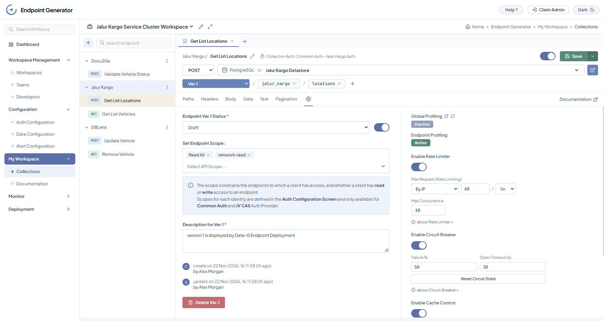
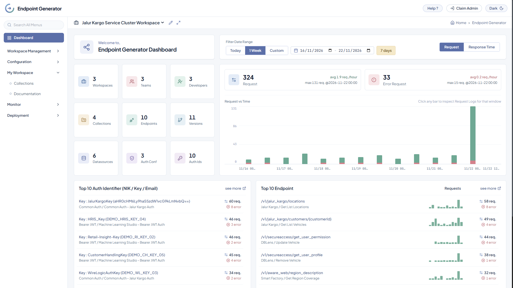
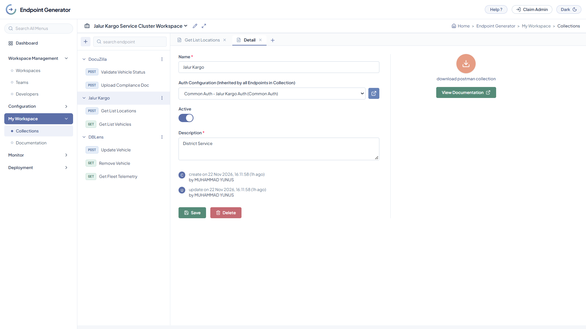
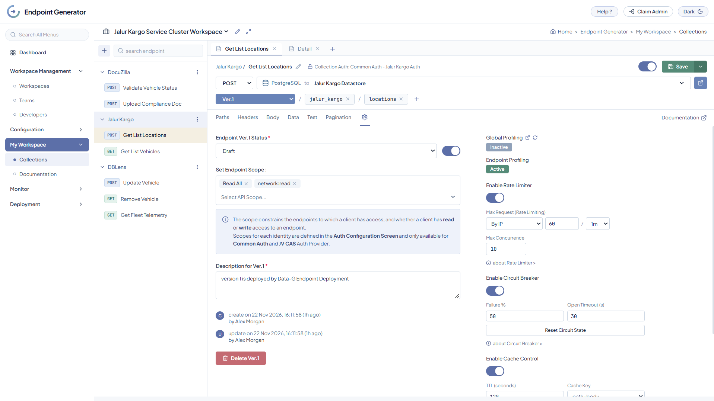
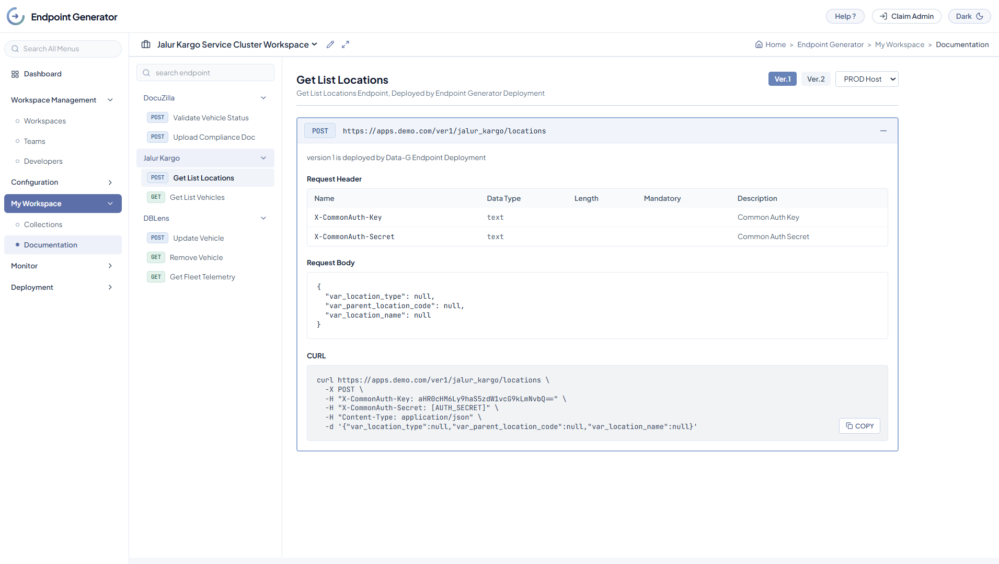
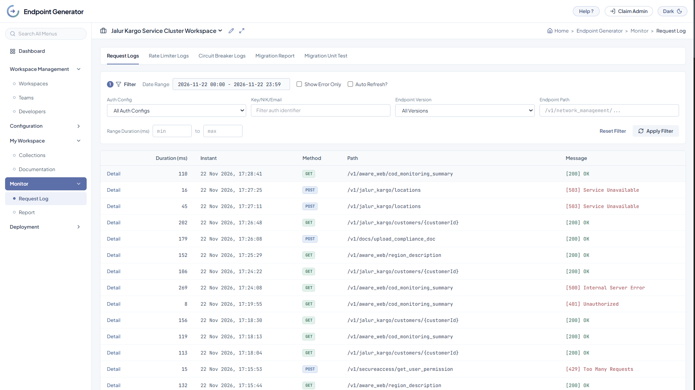
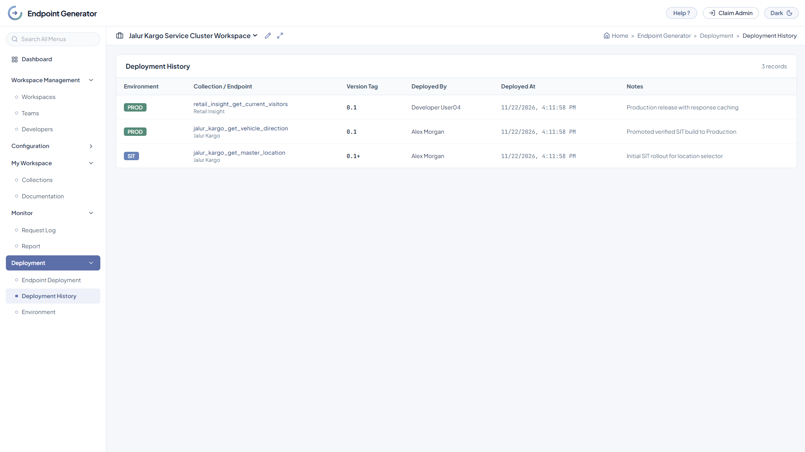
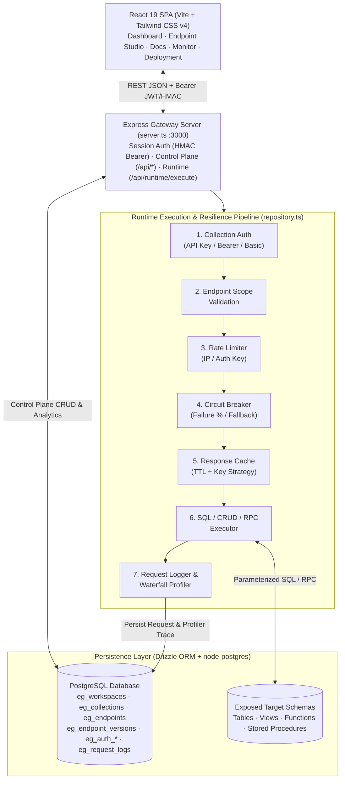

<div align="center">

# Endpoint Generator

**Enterprise Database-to-REST API Gateway & Control Plane**

*Expose PostgreSQL, MySQL, and SQL Server tables, views, functions, and stored procedures as versioned, resilient, documented REST APIs in seconds.*

<p>
  
  
  
  
  
  
  
</p>

`Multi-Tenant Workspaces` · `Collection-Level Auth Inheritance` · `Endpoint Versioning` · `Rate Limiter & Circuit Breaker` · `Response Caching` · `Live Request Profiler` · `Auto cURL & Postman Docs`

</div>

---

## Screenshots

<p align="center">
  
</p>

<table>
  <tr>
    <td width="33%" align="center">
      
      <br />
      <sub><strong>Analytics Dashboard</strong> — Traffic vs Time, KPIs & Top 10 Leaderboards</sub>
    </td>
    <td width="33%" align="center">
      
      <br />
      <sub><strong>Collection Auth</strong> — Collection-level Auth Inheritance & Postman Export</sub>
    </td>
    <td width="33%" align="center">
      
      <br />
      <sub><strong>Resilience Policies</strong> — Rate Limiter, Circuit Breaker & Cache Control</sub>
    </td>
  </tr>
  <tr>
    <td width="33%" align="center">
      
      <br />
      <sub><strong>API Documentation</strong> — Versioned Schemas, Headers & Copyable cURL</sub>
    </td>
    <td width="33%" align="center">
      
      <br />
      <sub><strong>Request & Resilience Monitor</strong> — Filterable Logs & Trace Profiler</sub>
    </td>
    <td width="33%" align="center">
      
      <br />
      <sub><strong>Deployment Pipeline</strong> — SIT & PROD Promotion History</sub>
    </td>
  </tr>
</table>

---

## Project Structure

```text
.
├── docs/                                # Repository documentation screenshots
│   ├── screen_eg_main.png
│   ├── screen_eg_2.png
│   ├── screen_eg_3.png
│   ├── screen_eg_4.png
│   ├── screen_eg_5.png
│   ├── screen_eg_6.png
│   └── screen_eg_7.png
├── src/
│   ├── components/
│   │   ├── ui/
│   │   │   └── MethodBadge.tsx          # HTTP verb badge component (GET/POST/PUT/DELETE)
│   │   ├── ApiDocumentation.tsx         # Auto-generated API docs, host switcher & cURL generator
│   │   ├── AuthModal.tsx                # Admin Claim / Sign-In modal
│   │   ├── ConfigurationManager.tsx     # Datasources & Auth Provider / Auth Identifier manager
│   │   ├── Dashboard.tsx                # Real-time KPIs, Recharts/SVG analytics & Top 10 tables
│   │   ├── DeploymentManager.tsx        # SIT / PROD deployment promotions, history & environments
│   │   ├── EndpointStudio.tsx           # Collection tree, Endpoint Studio, CRUD mapping & Test console
│   │   ├── EndpointWizard.tsx           # Guided SQL-to-REST Endpoint Wizard modal
│   │   ├── LogProfilerDrawer.tsx        # Waterfall execution profiler & request/response inspector
│   │   ├── RequestMonitor.tsx           # Request, Rate Limiter, Circuit Breaker & Migration reports
│   │   └── WorkspaceManagement.tsx      # Workspaces, Teams & Developers administration
│   ├── db/
│   │   ├── index.ts                     # Split-parameter PostgreSQL pool & schema bootstrapper
│   │   ├── repository.ts                # Drizzle data access, runtime executor, resilience & analytics
│   │   ├── schema.ts                    # Drizzle ORM PostgreSQL table definitions (eg_*)
│   │   └── seedData.ts                  # Clean demo seeds for workspaces, datasources, auth & logs
│   ├── lib/
│   │   └── api.ts                       # Typed frontend API client with Bearer token handling
│   ├── types/
│   │   └── domain.ts                    # Shared TypeScript domain interfaces & contracts
│   ├── App.tsx                          # Application shell, sidebar navigation, breadcrumbs & dark mode
│   ├── index.css                        # Tailwind CSS v4 entry & theme tokens
│   └── main.tsx                         # React 19 DOM entry point
├── server.ts                            # Unified Express API + Runtime Gateway + Vite/Static server
├── index.html                           # HTML entry & OpenGraph metadata
├── metadata.json                        # App identity & capability manifest
├── package.json                         # Scripts and runtime/dev dependencies
├── tsconfig.json                        # TypeScript compiler configuration
├── vite.config.ts                       # Vite 8 build & asset pipeline configuration
├── .env.example                         # Split PostgreSQL & runtime environment template
└── .gitignore                           # Ignored build artifacts, env files & local upload cache
```

---

## Application System Architecture



### Key Architectural Rules
1. **Strict Domain Hierarchy**: `Workspace` → `Collection` → `Endpoint` → `Endpoint Version (Ver.1, Ver.2, ...)`.
2. **Collection-Level Authentication Inheritance**: Auth Providers (`Common Auth`, `Bearer JWT`, `OAuth2/CAS`) and Auth Identifiers are attached at the **Collection** level; every endpoint inside a collection inherits the same auth provider while enforcing granular **Endpoint Scopes**.
3. **Datasource Binding & Version Flexibility**: Each Endpoint binds to a single **Database Connection (Datasource)**, while individual versions (`Ver.1`, `Ver.2`) can expose different database objects (Tables, Views, Functions, or Stored Procedures) and pagination/resilience policies.
4. **Database-Backed Observability**: Every test or gateway invocation records headers, payload, latency, status code, error stack, and waterfall profiler steps into `eg_request_logs`, driving the real-time Dashboard charts and Top 10 leaderboards.

---

## Tech Stack

| Layer | Technology | Version | Purpose |
| :--- | :--- | :--- | :--- |
| **Frontend** | React | `^19.0.1` | Component-driven SPA UI |
| **Styling** | Tailwind CSS + `@tailwindcss/vite` | `^4.3.3` | Responsive soft-pastel design system & Dark Mode |
| **Icons & Motion** | `lucide-react` / `motion` | `^0.546.0` / `^12.23.24` | UI iconography & smooth state transitions |
| **Build Tool** | Vite | `^8.3.0` | Fast HMR dev middleware & production bundling |
| **Backend Server** | Express (`tsx` runtime) | `^4.21.2` | REST control plane, runtime gateway & static serving |
| **ORM & Database** | Drizzle ORM + `pg` (`node-postgres`) | `^0.45.4` / `^8.23.1` | Type-safe schema, queries & PostgreSQL connection pool |
| **Language** | TypeScript | `^7.0.2` | End-to-end type safety across client, server & DB |

---

## How to Build

### 1. Prerequisites
- **Node.js** `>= 20.x` (ESM compatible)
- **PostgreSQL** `>= 14` (local instance, Supabase, or Cloud SQL)

### 2. Configure Environment Variables
Copy `.env.example` to `.env` and populate the split PostgreSQL connection parameters (no monolithic `DATABASE_URL` required):

```bash
cp .env.example .env
```

```env
APP_URL="http://localhost:3000"

# Split PostgreSQL connection parameters for Drizzle ORM
DB_HOST=your-postgres-host
DB_PORT=5432
DB_NAME=postgres
DB_USER=your-postgres-user
DB_PASSWORD=your-postgres-password
DB_SSL=true
```

### 3. Install Dependencies, Type-Check & Build

```bash
# Install packages
npm install

# Run TypeScript type check
npm run lint

# Start local full-stack dev server (Express + Vite middleware on port 3000)
npm run dev

# Build production frontend bundle into dist/
npm run build
```

> On first startup with an empty PostgreSQL database, `server.ts` automatically creates all `eg_*` control-plane tables, sample target schemas (`network_management`, `secure_access`, `hco_logistics`), and clean demo seed data idempotently.

---

## How to Deploy

### Option A — Standard Node.js Production Server

1. **Build the client bundle**:
   ```bash
   npm ci
   npm run build
   ```
2. **Set production environment variables** (`NODE_ENV=production` triggers `server.ts` to serve static files from `dist/` alongside `/api/*` routes on port `3000`):
   ```bash
   export NODE_ENV=production
   export APP_URL="https://your-gateway-domain.com"
   export DB_HOST="your-postgres-host"
   export DB_PORT="5432"
   export DB_NAME="postgres"
   export DB_USER="your-postgres-user"
   export DB_PASSWORD="your-postgres-password"
   export DB_SSL="true"
   ```
3. **Start the server**:
   ```bash
   npm start
   ```
4. **Verify health check**:
   ```bash
   curl http://localhost:3000/api/health
   # Expected: {"ok":true,"dbConnected":true}
   ```

### Option B — Container / Google Cloud Run

```dockerfile
FROM node:22-slim
WORKDIR /app

COPY package*.json ./
RUN npm ci

COPY . .
RUN npm run build

ENV NODE_ENV=production
EXPOSE 3000
CMD ["npm", "start"]
```

Configure `DB_HOST`, `DB_PORT`, `DB_NAME`, `DB_USER`, `DB_PASSWORD`, `DB_SSL`, and `APP_URL` as Cloud Run environment variables/secrets and route container traffic to port **3000**.
